<h1 align="center">Hi, I'm Rakan Dhiya 👋</h1>

<h3 align="center">Informatics Engineering Student</h3>

  

  

---

## 👨‍💻 About Me

I'm an Informatics Engineering student passionate about technology and software development. I enjoy learning how systems work, exploring new technologies, and turning ideas into practical projects.

- 🎓 Informatics Engineering Student
- 💻 Interested in Software Development
- 🤖 Exploring Artificial Intelligence and Machine Learning
- 🔐 Interested in Cybersecurity, Networking, and Linux
- 🌱 Always learning and improving my skills

## ⚡ Tech Stack

  

---

## 📊 GitHub Statistics

  

  

---

  Thanks for visiting my profile! ⭐

